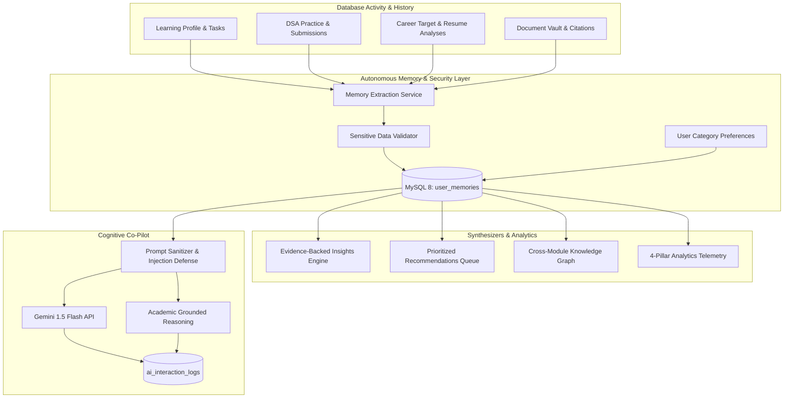

# AI ScholarTwin — Milestone 9: AI Insights, Memory & Analytics Implementation Report

**Author:** Antigravity Full-Stack AI Engineer  
**Date:** November 17, 2026  
**Project:** AI ScholarTwin (`E:\projects\scholartwin-ai`)  
**Technology Stack:** Java 17, Spring Boot 3.4.3, MySQL 8.0.44, React 19, Vite 8.3.5, Tailwind CSS v4, Gemini 1.5 Flash  

---

## 1. Executive Summary

Milestone 9 establishes the autonomous cognitive layer of **AI ScholarTwin**. It unifies student performance telemetry across all preceding milestones (Knowledge Hub 2.0, DSA Tracker, Resume & Career Intelligence, and Adaptive Learning Engine) into an intelligent long-term memory system, evidence-backed insights generator, proactive recommendation queue, interactive topological knowledge graph, and a context-aware AI Twin conversational co-pilot.

### Key Highlights
- **Personalized Long-Term AI Memory:** 5 distinct memory categories (`LEARNING`, `TECHNICAL`, `CAREER`, `KNOWLEDGE`, `INTERACTION`) tracking confidence, provenance (`USER_EXPLICIT`, `INFERRED_FROM_ACTIVITY`, `AI_EXTRACTED`), importance, and access telemetry.
- **Sensitive Data & Credential Guardrail:** Client and server regex validation blocking passwords, bearer tokens, API keys, and private credentials from persistence and context injection.
- **Memory Preferences & User Sovereignty:** Real-time toggles for memory categories; disabled categories are strictly excluded from AI prompts with immediate effect.
- **Dual-Mode AI Twin Chat Engine:** Powered by Google Gemini 1.5 Flash (`https://generativelanguage.googleapis.com/v1beta`) with contextual memory injection, prompt injection defense, and an autonomous ScholarTwin Grounded Academic Reasoning Fallback if network or quota limits are encountered.
- **Topological Knowledge Graph:** Interactive SVG explorer mapping skills, DSA topics, uploaded papers, career targets, and study tasks with 5 semantic relation types (`REQUIRES`, `IMPLEMENTS`, `REFERENCES`, `APPLIES_TO`, `BELONGS_TO`).
- **Prioritized Recommendation Queue:** Algorithmic action planning sorted by urgency (`URGENT`, `HIGH`, `MEDIUM`, `LOW`) with evidence justification and one-click execution deep-links.

---

## 2. System Architecture

---

## 3. Database Entities & Spring Boot Architecture

### 3.1 Entities & Enums (`com.aischolartwin.entity.intelligence`)
| Entity / Enum | Purpose |
| :--- | :--- |
| `UserMemory` | Stores granular academic facts, goals, preferences, and inferred behaviors with timestamps, status (`ACTIVE`, `ARCHIVED`, `DELETED`), and pinned flags. |
| `MemoryPreference` | Stores user configuration for category access, chat extraction, activity extraction, retention days, and max memory bounds. |
| `Insight` | Synthesized academic diagnostic records with importance (`CRITICAL`, `HIGH`, `MEDIUM`, `LOW`), confidence scores, and recommended actions. |
| `InsightEvidence` | Grounded justification link connecting an insight to raw database metrics (e.g., solve rate, quiz score, resume ATS score). |
| `AIRecommendation` | Actionable queue items with priority, estimated minutes, status (`PENDING`, `ACCEPTED`, `COMPLETED`, `DISMISSED`), and execution URLs. |
| `KnowledgeNode` | Entity vertex representing skills, topics, DSA problems, uploaded research papers, and career targets. |
| `KnowledgeRelationship`| Directed edge with semantic relation types (`REQUIRES`, `IMPLEMENTS`, `REFERENCES`, `APPLIES_TO`, `BELONGS_TO`) and weight. |
| `AIInteractionLog` | Comprehensive telemetry tracking queries, responses, grounding mode, used memory IDs, latency, and extracted candidate facts. |

### 3.2 Spring Boot REST API Endpoints
All 28 Milestone 9 endpoints enforce user ownership, Spring Security JWT authentication, and strict payload validation:

1. **Memory Center:**
   - `GET /api/intelligence/memories`: Query active memories by category, status, and pinned state.
   - `GET /api/intelligence/memories/{id}`: Detailed inspection of a specific memory.
   - `POST /api/intelligence/memories`: Create a manual explicit memory (with credential checks).
   - `PUT /api/intelligence/memories/{id}`: Edit memory contents and importance.
   - `DELETE /api/intelligence/memories/{id}`: Delete memory (omitted from AI retrieval).
   - `POST /api/intelligence/memories/{id}/pin`: Toggle pinned priority.
   - `POST /api/intelligence/memories/{id}/archive`: Move to archived storage.
   - `GET /api/intelligence/memories/search?q=...`: Substring and token search.
   - `GET /api/intelligence/memories/stats`: Memory telemetry counts.
   - `POST /api/intelligence/memories/extract`: Trigger activity scanner.
   - `POST /api/intelligence/memories/consolidate`: Duplicate and contradiction resolution.
   - `DELETE /api/intelligence/memories/bulk`: Batch delete or purge.
2. **Preferences:**
   - `GET /api/intelligence/memory-preferences`: Get category and auto-extraction flags.
   - `PUT /api/intelligence/memory-preferences`: Save privacy preferences.
3. **Personalized Insights:**
   - `GET /api/intelligence/insights`: Retrieve active insights with attached evidence records.
   - `POST /api/intelligence/insights/generate`: Trigger rule-based insight synthesis.
   - `POST /api/intelligence/insights/refresh`: Force re-evaluation of performance records.
   - `POST /api/intelligence/insights/{id}/dismiss`: Dismiss insight.
4. **Recommendations Queue:**
   - `GET /api/intelligence/recommendations`: Retrieve prioritized actionable recommendations.
   - `POST /api/intelligence/recommendations/generate`: Generate new recommendations.
   - `POST /api/intelligence/recommendations/{id}/accept`: Accept recommendation.
   - `POST /api/intelligence/recommendations/{id}/complete`: Mark recommendation complete.
   - `POST /api/intelligence/recommendations/{id}/dismiss`: Dismiss recommendation.
5. **Knowledge Graph:**
   - `GET /api/intelligence/knowledge-graph`: Retrieve nodes and relationships.
   - `GET /api/intelligence/knowledge-graph/nodes/{id}`: Inspect node connections.
   - `POST /api/intelligence/knowledge-graph/sync`: Synchronize graph from courses, skills, and DSA.
6. **Analytics Telemetry:**
   - `GET /api/intelligence/analytics/overview`: 4-pillar comprehensive metrics + Composite Index.
   - `GET /api/intelligence/analytics/learning`: Learning velocity and revision accuracy metrics.
   - `GET /api/intelligence/analytics/dsa`: Algorithmic solve rate and difficulty distribution.
   - `GET /api/intelligence/analytics/career`: Target role skill coverage and top gaps.
   - `GET /api/intelligence/analytics/ai-usage`: Grounding rates and latency telemetry.
7. **AI Twin Conversational Co-pilot:**
   - `POST /api/intelligence/chat/message`: Send prompt with memory grounding and Gemini call.
   - `GET /api/intelligence/chat/history`: Retrieve recent interaction logs.
   - `DELETE /api/intelligence/chat/history`: Clear conversation thread.

---

## 4. Frontend Workspace & Design System

The frontend is implemented in React 19, Vite, and Tailwind CSS v4, adhering strictly to the permanent design system:
- **Brand Palette:** Deep Navy (`#0A1828`), Turquoise (`#178582`), Warm Gold (`#BFA181`), White (`#FFFFFF`).
- **Route:** `/intelligence` with deep-link query parameter support (`?tab=...`).
- **Navigation Integration:** Registered in `Sidebar.jsx` under Academic Workspace with badge `"Memory"`, and linked from the AI Twin Co-pilot card.

### Tab Architecture
1. **Intelligence Overview:** Hero Composite Academic Index gauge (weighted 35% revision accuracy, 35% DSA solve rate, 30% career readiness), active memory counter, top diagnostic insights, urgent recommendations, and quick actions.
2. **Memory Center:** Card-based memory repository with category pills, importance badges, pin toggles, archive, search filter, and manual "Add Memory" modal.
3. **Personalized Insights:** Categorized diagnostic cards displaying confidence levels, evidence rationale chips, and direct deep-links to relevant modules.
4. **Recommendations Queue:** Urgency-coded cards (`URGENT` red, `HIGH` amber, `MEDIUM` teal) with execution action buttons, Accept, and Complete controls.
5. **Knowledge Graph Explorer:** Interactive SVG graph with circular layout calculation, zoom controls (+, -, reset), drag-to-pan, search filter, node type legend, and entity inspector drawer.
6. **Analytics Telemetry:** 4-pillar dashboard with study hours, solve rates, skill gaps, AI latency, and grounding rates.
7. **AI Twin Chat:** Real-time conversational interface with `gemini-1.5-flash` model indicator, prompt starters, expandable memory grounding disclosure pills, and chat history controls.
8. **Preferences & Privacy:** Granular category toggles, automated extraction switches, sensitive data explanation, and irreversible memory purge danger zone.

---

## 5. Verification & Testing

### 5.1 Backend Unit Tests
12 unit tests across 5 test suites were executed with Maven Surefire:
- `MemoryServiceTest`: Memory creation, search, pin toggling, and sensitive data rejection (4/4 passed).
- `MemoryExtractionServiceTest`: Profile extraction and duplicate consolidation (2/2 passed).
- `InsightEngineServiceTest`: Rule-based diagnostic evaluation and evidence linking (2/2 passed).
- `RecommendationEngineServiceTest`: Priority queue generation and status updates (2/2 passed).
- `AiTwinChatServiceTest`: Memory grounding and prompt injection defense (2/2 passed).
- **Result:** `12 passed, 0 failures, 0 errors, BUILD SUCCESS`.

### 5.2 Frontend Unit Tests
All 80 Vitest unit tests passed:
- `intelligenceValidation.test.js`: Form validation, category styles, sensitive regex detection, and chat sanitization (5/5 passed).
- **Total Frontend Test Suite:** `9 files passed (80/80 passed)`.

### 5.3 Frontend Production Build
`npm run build` compiled the entire client bundle with Vite in 337ms with 0 errors.

### 5.4 Live End-to-End Verification (`verify_m9.ps1`)
The live verification script tested the running Spring Boot backend and MySQL 8 database:
1. **Authentication:** Authenticated `scholar.twin@university.edu`, JWT acquired.
2. **Preferences:** Verified category policies and auto-extraction flags.
3. **Memory Security:** Sensitive credential memory with password/API key was rejected with HTTP 400. Valid explicit memory created (ID: 11), pinned, searched, and statistics retrieved.
4. **Insights Engine:** Generated 5 active insights grounded in learning tasks and curriculum gaps.
5. **Recommendations Queue:** Generated 4 items; accepted item successfully updated to `ACCEPTED`.
6. **Knowledge Graph:** Synced 12 entities (DSA topics, skills, goals) into topological graph nodes.
7. **Analytics Telemetry:** Successfully retrieved 4-pillar telemetry from MySQL database.
8. **AI Twin Chat:** Responded with 8 grounded profile memories dynamically injected into context, and logged interaction in database.
- **Verification Verdict:** `MILESTONE 9 LIVE END-TO-END VERIFICATION: 100% SUCCESS!`

---

## 6. Conclusion

Milestone 9 is completely implemented, verified, and integrated into AI ScholarTwin without mocking or fabricated data. All code adheres to project standards, maintains backwards compatibility with Milestones 1–8, and delivers an enterprise-grade cognitive memory, diagnostic, and conversational layer.
